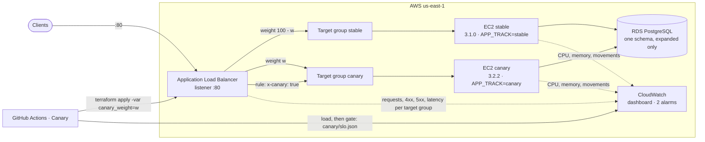
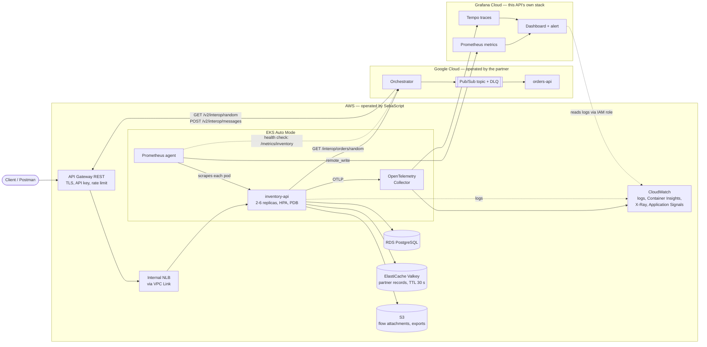

# Inventory API

RESTful inventory API with NestJS + TypeScript + PostgreSQL.

```bash
git clone https://github.com/SebaScript/inventory-api-v2.git
cd inventory-api-v2
cp .env.example .env

npm run docker:dev            # http://localhost:3000  ·  /docs  ·  /health
```

That builds the image and raises the API together with its PostgreSQL, so
Docker is the only thing you need installed. To run the API on your own machine
instead, `npm install` and `npm run start:dev`, with `npm run db:up` giving you
just the database.

There is nothing to migrate: locally, TypeORM builds the schema from the entities
on boot (`synchronize: true`), which is convenient here and would be dangerous on
a database holding real data. Production turns it off: see
[Expand / Contract](#expand--contract). `SEED=true` loads demo data, and the
application refuses to seed whenever `NODE_ENV=production`.

## Canary deployment

A new version reaches production next to the current one and earns its traffic in
stages. If it fails a stage, every request goes back to the stable version on its
own.



| | |
| --- | --- |
| Provider | AWS (`us-east-1`), everything in [`terraform/`](terraform/README.md) |
| Routing | The ALB listener forwards to two target groups by weight. A rule ahead of it sends any request with `x-canary: true` to the canary, whatever the weight |
| Artifact | One Docker image per commit in ECR, tagged with the commit SHA. Tags are immutable: a tag always names the same image |
| Who answered | Every response, errors and docs included, carries `X-App-Version` (from `package.json`) and `X-App-Track` (`stable` or `canary`) |

### Two API versions in production

| | stable track | canary track |
| --- | --- | --- |
| Release | 3.1.0 | 3.2.2 |
| `/api/v2/...` | yes | yes, the same answers |
| `/api/v3/...` | no | yes: items carry their bin `location` |
| `/api/...` without a version | served as v2 | served as v3 |

`/api/...` without a version serves the newest version the build has, so the same
URL answers v2 or v3 depending on where the split sends it. Before promotion,
`/api/v3/...` is reached with `x-canary: true`.

### Stages

| Stage | Canary share | How traffic gets there | Observation | Decided by |
| --- | --- | --- | --- | --- |
| 0 | 0% of the public | Only requests with `x-canary: true` | Until the canary target is healthy, then a smoke test of each track | Health check and headers |
| 1 | 10% | ALB weights 90 / 10 | 3 min under 25 req/s: about 450 canary requests | Alarms during the bake, then the gate |
| 2 | 50% | ALB weights 50 / 50 | 3 min: about 2,250 canary requests | Same |
| 3 | 100% | ALB weights 0 / 100 | 3 min: about 4,500 canary requests | Same, on objectives only: no baseline is left |
| Promoted | 0% | Stable is rebuilt with the canary's image, then the weight returns to 0 | | |

*Actions → Canary → Run workflow*:

- **deploy**, run on the commit or tag to release: builds its image if needed and puts it on the canary at 0% (stage 0);
- **promote**: walks stages 1 to 3. `fault` makes the load ask the canary to fail, to rehearse an abort; `bake_minutes` sets each observation;
- **rollback**: 0% to the canary, at once.

A weight change is one `terraform apply` of the listener and takes about ten
seconds. The load in each stage comes from [`canary/load.ts`](canary/load.ts): a
steady, open-loop mix of reads and stock movements, the same for both tracks, that
counts who answered each request. Run it from anywhere to see the split:

```bash
npx ts-node canary/load.ts --url http://<alb> --seconds 60 --rps 20
```

Sticky sessions are off: each request is routed on its own, which keeps the split
exact, and one client may see v2 and then v3 on `/api/...`. Target-group stickiness
on the listener would pin each client to one track, at the cost of a coarser split.

### Promote, pause or abort: `canary/slo.json`

The thresholds are versioned with the code. Terraform builds the alarms from them,
and [`canary/gate.ts`](canary/gate.ts) judges each stage with them, from what
CloudWatch measured on each target group during the bake.

| Signal | Pause above | Abort above |
| --- | --- | --- |
| Canary 5xx rate | 1% | 5% |
| Canary 4xx rate | 5% | 15% |
| Canary p95 latency | 400 ms | 1,000 ms |
| Canary 5xx rate minus stable's | 1 point | 3 points |
| Canary p95 minus stable's | 100 ms | 300 ms |

- **Abort** if any signal crosses its abort line, or if either alarm fires: the canary drops to 0% and the run fails.
- **Pause** if any crosses a pause line, or if the canary served fewer than **300 requests**: the weight stays and the run ends with a warning, for a person to promote or roll back.
- **Promote** otherwise: on to the next stage.

The comparison with stable covers the same minutes under the same load, so neither
track is judged against a quieter hour. It applies only while stable still receives
traffic: at 100% the canary is judged on its objectives alone.

Why 300 requests: to know an error rate near the 5% abort line within ±2.5 points
at 95% confidence takes n = 1.96² × 0.05 × 0.95 / 0.025² ≈ 292. At 25 req/s the
canary gets that many within three minutes even at 10%.

### Fault injection

On the canary only, `x-fault: error` answers 500 and `x-fault: latency` answers
1.5 s late. The stable track ignores the header, so the same request shows both:

```bash
curl -i -H "x-canary: true" -H "x-fault: error" http://<alb>/api/items   # 500, X-App-Track: canary
curl -i -H "x-fault: error" http://<alb>/api/items                       # 200, X-App-Track: stable
```

The fault answers before any handler runs, so a failing canary writes nothing: the
data stays intact through the abort.

### Automatic abort

Two CloudWatch alarms watch the canary's target group every minute:
`inventory-api-canary-errors` (5xx rate above 5%, with at least 30 requests in the
minute) and `inventory-api-canary-latency` (p95 above 1 s). Each fires on two
breaching minutes out of three. While a stage bakes, the pipeline checks them every
20 seconds; one firing ends the stage early and sets the weight back to 0. After the
bake, the gate judges the whole window.

### Dashboard

`terraform output dashboard_url` opens it. Every widget draws stable in green and
the canary in orange, side by side: requests per minute, the canary's share of
traffic (the stages and the rollback show up as steps), 5xx and 4xx rates, latency
p50/p95/p99, CPU, memory, and **movements recorded per minute**, the business
metric. Below them, the state of both alarms. The ALB measures traffic, errors and
latency per target group, EC2 reports CPU every minute, and the API itself
publishes memory and movements, tagged with its track.

### Expand / Contract

Both tracks share one database and either may be rolled back at any moment, so
while two versions run the schema may only grow.

1. **Expand (3.2.0).** Before the canary starts, its seed step runs
   `ALTER TABLE items ADD COLUMN IF NOT EXISTS location varchar(40)`
   ([`src/database/schema.ts`](src/database/schema.ts)). Nullable and without a
   default, PostgreSQL adds it without rewriting the table, and 3.1.0's inserts stay valid.
2. **Both versions run.** v3 reads and writes `location`. The column is not selected
   unless asked for, so v1 and v2 answer exactly as before; v2 rejects it in a body,
   and v2 updates leave it untouched.
3. **Contract, later and never during a canary.** Only once no running build ignores
   the column may a later release backfill it and make it required. Nothing is ever
   renamed or dropped by the release that stops using it.

A rollback keeps everything: the column and what v3 wrote stay, ignored by 3.1.0,
and are back with the next promotion.

What makes this hold: production runs with `DB_SYNC=false`, and the schema is built
from the entities only on an empty database. TypeORM's `synchronize` in the old
build would drop the column the new one added, exactly the destructive migration a
canary cannot have. Both tracks boot at once on a new database, so the seed step
takes a PostgreSQL advisory lock: one builds and seeds, the other waits.

## Architecture

Two APIs, two clouds, one orchestrator between them. Each API is deployed whole
in its own provider and neither holds a copy of the other's data: a record from
the other side is fetched over HTTP, in real time, through the orchestrator.



## API

The paths below are listed unversioned. Each one also exists under `/v2` with
identical behaviour.

### Groups: `/groups`

A group is a category. It is the dimension items are classified by.

| Method   | Path          | What it does                                                      |
| -------- | ------------- | ----------------------------------------------------------------- |
| `POST`   | `/groups`     | Creates a category. The name is unique, case insensitive          |
| `GET`    | `/groups`     | Lists categories, paginated. `?search` matches the name           |
| `GET`    | `/groups/:id` | Returns one category                                              |
| `PATCH`  | `/groups/:id` | Updates only the fields that were sent; the rest stay as they are |
| `DELETE` | `/groups/:id` | Deletes it, but only if it is empty, otherwise `409`             |

### Items: `/items`

An item is a product. It holds the **current state**: how much stock there is right now.

| Method      | Path                | What it does                                                                                                                               |
| ----------- | ------------------- | ------------------------------------------------------------------------------------------------------------------------------------------ |
| `POST`      | `/items`            | Creates a product inside a category. An optional opening stock is written as an `IN` movement, so even the first units have a ledger entry |
| `GET`       | `/items`            | Lists products with their category. Filters: `?search` (name or SKU), `?groupId`, `?lowStock`, `?status`                                   |
| **`QUERY`** | **`/items/search`** | Advanced search whose filter travels in the **body**: free text, a _list_ of categories and a price range                                  |
| `POST`      | `/items/search`     | The same search, for clients and tools that cannot send the QUERY verb                                                                     |
| `GET`       | `/items/:id`        | Returns one product, discontinued ones included                                                                                            |
| `PATCH`     | `/items/:id`        | Updates only the fields that were sent. The stock is never one of them. Also brings a product back with `{"status":"ACTIVE"}`              |
| `DELETE`    | `/items/:id`        | **Discontinues** it: it leaves the listings and accepts no more movements, but neither it nor its history is erased                        |


### Movements: `/movements`

A movement is an entry or exit of stock. It is the **immutable event log** that explains every unit, hence no `PUT`, `PATCH` or `DELETE`. A mistake is corrected with an opposite movement.

| Method | Path             | What it does                                                                                                                                                            |
| ------ | ---------------- | ----------------------------------------------------------------------------------------------------------------------------------------------------------------------- |
| `POST` | `/movements`     | Records an `IN` or `OUT` **and** updates the item's stock in a single transaction, with the row locked. `409` if there is not enough stock, and then nothing is written |
| `GET`  | `/movements`     | Lists the ledger, newest first. Filters: `?itemId`, `?type`                                                                                                             |
| `GET`  | `/movements/:id` | Returns one entry together with its product                                                                                                                             |

### Health: `/health`

| Method | Path      | What it does                                                               |
| ------ | --------- | -------------------------------------------------------------------------- |
| `GET`  | `/health` | Runs a real query against PostgreSQL. `503` if the database is unreachable |

### Errors

Every failure has the same shape. Branch on `code`, not on `message`.

```jsonc
{
  "statusCode": 409,
  "code": "INSUFFICIENT_STOCK",
  "message": "Item 1 has 75 unit(s) available, 99999 requested",
  "available": 75,
  "requested": 99999,
  "path": "/movements",
  "timestamp": "2026-08-18T15:29:44.337Z",
}
```

| Status | When                                                                           |
| ------ | ------------------------------------------------------------------------------ |
| `400`  | Validation failed (body, params, query)                                        |
| `404`  | The resource does not exist                                                    |
| `409`  | Duplicate name/SKU, non-empty group, discontinued item, **insufficient stock** |
| `422`  | A database rule was broken                                                     |
| `500`  | Unexpected: generic message only, details go to the log                       |
| `503`  | Health check: PostgreSQL unreachable                                           |

In production an unexpected error returns only `"Internal server error"`. A test asserts that a thrown error containing a password never appears in the response.

## Database

```
      Group                          Item                        Movement
  ┌───────────┐                 ┌────────────┐               ┌────────────────┐
  │ id        │                 │ id         │               │ id             │
  │ name  (U) │ 0..N       1..1 │ group_id   │          0..N │ item_id        │
  │ descrip.  │◄──── clasifica ─┤ sku    (U) │◄─── registra ─┤ type  (IN|OUT) │
  │ created   │                 │ quantity   │          1..1 │ quantity  > 0  │
  │ updated   │                 │ min_stock  │               │ resulting_stock│
  └───────────┘                 │ unit_price │               │ reason         │
                                │ status     │               │ created_at     │
                                └────────────┘               └────────────────┘
                ON DELETE RESTRICT            ON DELETE RESTRICT
```

| Rule                                   | Why                                                             |
| -------------------------------------- | --------------------------------------------------------------- |
| `UNIQUE` name on groups                | One category per name; the API also compares case-insensitively |
| `UNIQUE` sku (stored uppercase)        | Makes SKU uniqueness real, not cosmetic                         |
| `CHECK (quantity >= 0)`                | The invariant's last line of defence                            |
| `CHECK (quantity > 0)` on movements    | Direction comes from `type`, never from a sign                  |
| `ON DELETE RESTRICT` groups → items    | Deleting a category must not destroy inventory                  |
| `ON DELETE RESTRICT` items → movements | A movement can never be orphaned; history is permanent          |

The central rule is that an item's stock always equals the sum of its own
movements, and is never negative. Four layers defend it: the update DTO has no
`quantity` field at all, every movement runs inside a transaction, the item row
is locked with `SELECT … FOR UPDATE`, and PostgreSQL holds a `CHECK` constraint
underneath. A test fires two concurrent `OUT` movements against the same item
and asserts that exactly one of them fails.

## Docker

| File                 | What it is                                                                                                                                                                                    |
| -------------------- | --------------------------------------------------------------------------------------------------------------------------------------------------------------------------------------------- |
| `Dockerfile`         | Two stages: the first compiles and prunes the dev dependencies, the second copies only `node_modules` and `dist`. It runs as the `node` user and carries a `HEALTHCHECK` that calls `/health` |
| `docker-compose.yml` | Two services: `postgres`, and `api` built from that Dockerfile. The API waits for `service_healthy`, not merely for the container to exist                                                    |

Two details worth knowing, both of which cost an afternoon once:

- The volume is mounted at `/var/lib/postgresql`. Postgres 18 moved its cluster
  there, and mounting the `/data` subdirectory earlier versions used stops the
  container from starting.
- The healthcheck calls `127.0.0.1`, not `localhost`, which inside the
  container resolves to `::1` where nothing is listening.

The database is published on host port **5433**, because 5432 is usually taken
by a PostgreSQL installed directly on the machine. Everything is parameterised
through `.env`: `DB_PORT`, `DB_USER`, `DB_PASSWORD`, `DB_NAME`, `API_PORT`.

## Tests

The suite runs end to end against a **real PostgreSQL**: it asserts on
transactions, row locks and `CHECK` constraints, none of which can be faked.
Docker supplies that database:

```bash
npm run db:up      # PostgreSQL alone, on localhost:5433
npm test           # reads DATABASE_URL from .env
```

The tables are truncated between tests, so do not point `DATABASE_URL` at a
database holding anything you want to keep. `npm run db:down` removes the
container and its volume.

| File                         | Covers                                                                         |
| ---------------------------- | ------------------------------------------------------------------------------ |
| `test/groups.spec.ts`        | Group CRUD, uniqueness, delete rules                                           |
| `test/items.spec.ts`         | Item CRUD, filters, **the QUERY endpoint**, discontinuation                    |
| `test/movements.spec.ts`     | IN, OUT, insufficient stock, **concurrency**, the CHECK constraint             |
| `test/errors.spec.ts`        | Error shape, database error mapping, no leaks in production                    |
| `test/app.spec.ts`           | Health check, OpenAPI document, release headers, the schema guard, demo data   |
| `test/v2.spec.ts`            | The `/v2` surface, shared data, QUERY under v2, the Swagger tags               |
| `test/v3.spec.ts`            | The bin location, v1 and v2 never seeing it, the expand step                   |
| `test/canary.spec.ts`        | Fault injection on the canary only, the business metric                        |
| `test/gate.spec.ts`          | Every promote, pause and abort decision of the canary gate                     |
| `test/health.spec.ts`        | Liveness surviving a database outage while readiness fails                     |
| `test/cache.spec.ts`         | Cache keys, the fallback with no cache server, invalidation                    |
| `test/exports.spec.ts`       | CSV escaping, the metric document, the unconfigured export                     |
| `test/observability.spec.ts` | Correlation, the route labels, probes staying out of the metrics               |
| `test/interop.spec.ts`       | The shared record shape, randomness, and every way the partner lookup degrades |

Every cloud-backed feature is off when its variable is unset, so the whole suite
runs with nothing but PostgreSQL.

## Infrastructure as code

[`terraform/`](terraform/README.md) creates six AWS services in one apply: a load
balancer, two EC2 machines that run the API with Docker (stable and canary), an RDS
database, an ECR registry, an S3 bucket and the CloudWatch dashboard and alarms. The
`Infrastructure` workflow deploys it, installs the API, and destroys it on demand;
the `Canary` workflow rolls a new version out on it.

## Deploying to a cluster

`deploy/` holds the Kubernetes manifests: a Deployment with real probes, an
internal load balancer, and a one-off Job that creates the schema and loads the
demo data. Three optional features switch on through the environment:

| Variable           | Off means                                         | On adds                                                   |
| ------------------ | ------------------------------------------------- | --------------------------------------------------------- |
| `DB_SSL`           | plaintext connection, as a local database expects | TLS, which a managed database requires                    |
| `REDIS_URL`        | every listing reads the database                  | `GET /v2/items` served from a distributed cache           |
| `S3_BUCKET`        | `POST /v2/exports/items` answers `503`            | a CSV snapshot in object storage, behind a presigned link |
| `ORCHESTRATOR_URL` | `partner` reports `disabled`, nothing is called   | records fetched live from the other cloud                 |

Two probes rather than one, because they answer different questions.
`/health/live` never touches the database: a liveness probe that does turns a
brief database outage into a restart of every replica. `/health/ready` does
check it, and starts failing the moment the process is asked to shut down, so
the load balancer stops sending it new work before the socket closes.

`deploy/hpa.yaml` adds horizontal autoscaling on CPU, from 2 replicas to 6.
The floor stays at 2 on purpose: an autoscaler allowed to reach one replica
would quietly undo the redundancy it was added to protect. It needs
metrics-server, which EKS Auto Mode does not ship. `deploy/load-test.yaml` is a four-minute burst from inside
the cluster to watch it happen: measured, two replicas become six in under a
minute, and go back to two five minutes after the load stops.

## Behind a gateway or an orchestrator

The API is a well-behaved downstream service, and nothing below changes how it
answers when it is called directly.

**Every request carries a correlation id.** `X-Correlation-Id` is honoured when
the caller sends one, `X-Request-Id` is accepted as an alias, and one is
generated when neither is present. It comes back on the response and appears in
both the access log and the error log, which is the only way a call is
traceable once it has crossed a service boundary.

**`GET /metrics` publishes Prometheus metrics** for an external collector:
request counts and durations, cache hits and misses, and the usual process
metrics. Two deliberate choices there: the `route` label is the route pattern,
never the resolved URL, so item ids cannot multiply the time series; and health
probes and the scrape itself are left out, so a kubelet polling every ten
seconds cannot drown the real traffic.

**Two routes make up the cross-service contract.** `GET /v2/interop/random`
hands one record to whoever asks, in a deliberately domain-agnostic shape
(`source`, `kind`, `id`, `label`, `attributes`, `retrievedAt`) so neither side
has to model the other. And `GET /v2/items/:id` returns the item plus a
`partner` block holding a record fetched from the other service through the
orchestrator.

That lookup is never allowed to matter. It reports `ok`, `unavailable` or
`disabled` rather than throwing, runs behind a short timeout, and happens only
after the local read has succeeded: an unknown id still 404s without anyone
else being called. Every failure mode is covered by a test, and with
`ORCHESTRATOR_URL` unset the whole thing reports `disabled` and the API behaves
exactly as it always has. The unversioned `GET /items/:id` is untouched: this is
the first real divergence the `/v2` surface was built for.

**`POST /v2/interop/messages` is this API's step in the cross-cloud flow.** The
orchestrator posts the message it is carrying; this API appends one of its items
to `entities`, writes the accumulated JSON to object storage under
`flows/<correlation id>/`, and appends a presigned link to `attachments`.
Everything else in the message comes back untouched, so no step can erase
another's. The correlation id becomes part of an object key, so it is reduced
to characters that cannot leave that prefix. Without a bucket the item is
still added and no file is written.

**Logs and traces point at each other.** Every request log line carries the
OpenTelemetry `traceId`, and every request span carries the correlation id as
`app.correlation_id`. From a log line you reach its trace; from the id another
cloud logged, you find the trace here. The SDK itself is injected by the
cluster, not bundled: `@opentelemetry/api` is the only dependency, and with no
SDK loaded both stamps are no-ops.

**Partner record is cached, and only when it is good.** A successful lookup is stored for `PARTNER_CACHE_TTL_SECONDS` (30 by default) in its own
cache namespace, so a burst of reads is one cross-cloud call rather than one
each. A failure is never stored: caching an outage would make it outlive
itself. Expiry bounds how stale a record can get; `DELETE /v2/interop/cache`
is the way to force a refresh straight away, which is what makes a change
made on the other side visible immediately instead of up to a TTL later.

## Scripts

| Command              | What it does                                        |
| -------------------- | --------------------------------------------------- |
| `npm run docker:dev` | Builds and raises the whole stack, API and database |
| `npm run db:up`      | Raises only PostgreSQL, on `localhost:5433`         |
| `npm run db:down`    | Tears the stack down, volume included               |
| `npm run start:dev`  | Runs the API on the host, with reload               |
| `npm run build`      | Compiles to `dist/`                                 |
| `npm test`           | Runs the suite                                      |
| `npm run lint`       | ESLint over `src` and `test`                        |
| `npm run typecheck`  | `tsc --noEmit`                                      |
| `npm run format`     | Prettier over `src` and `test`                      |
