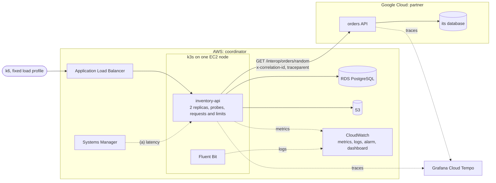

# Inventory API

RESTful inventory API with NestJS + TypeScript + PostgreSQL.

```bash
git clone https://github.com/SebaScript/inventory-api-v2.git
cd inventory-api-v2
cp .env.example .env

npm run docker:dev            # http://localhost:3000  ·  /docs  ·  /health
```

That builds the image and raises the API together with its PostgreSQL, so
Docker is the only thing you need installed. To run the API on your own machine
instead, `npm install` and `npm run start:dev`, with `npm run db:up` giving you
just the database.

There is nothing to migrate: locally, TypeORM builds the schema from the entities
on boot (`synchronize: true`), which is convenient here and would be dangerous on
a database holding real data. Production turns it off: see
[Expand / Contract](#expand--contract). `SEED=true` loads demo data, and the
application refuses to seed whenever `NODE_ENV=production`.

## Chaos engineering

The API runs on Kubernetes and coordinates a synchronous flow across two clouds:
`GET /v2/items/:id` reads an item here and fetches a record from the partner API in
Google Cloud, carrying the correlation id and the W3C `traceparent` with it. Three
faults are injected into that flow, each as a versioned experiment with a falsifiable
hypothesis, and one of them runs in the pipeline as a quality gate.

| Owner | Fault | Injection | Target metric (k6) | Resilience patterns |
| --- | --- | --- | --- | --- |
| Coordinator (AWS) | (a) +2 s on the call to the partner | AWS document `AWSFIS-Run-Network-Latency-Sources`, sent through SSM | p95 of `GET /v2/items/:id` | timeout per dependency, circuit breaker |
| Coordinator (AWS) | (c) connection pool exhausted | own fault switch: `x-fault: slow-db` | p95 of `GET /items/:id` | bulkhead, query timeout |
| Partner (GCP) | (b) partner database unreachable | partner's fault switch: `FAULT_DB` | share of the flow with `partner.status = ok` | database timeout, fallback cache |

- **Load:** [`chaos/load.js`](chaos/load.js) is the only instrument, with the profile
  fixed in [`chaos/slo.json`](chaos/slo.json): 30 s ramp to 20 requests per second,
  150 s plateau, 15 s ramp down. Half the requests are the flow, half plain reads.
- **Experiments:** [`chaos/experiments/`](chaos/experiments/) holds one Chaos Toolkit
  file per fault. Its `chaos-card` extension states the steady state, the hypothesis,
  the injection, the blast radius, the duration, the abort conditions and the
  rollback. Chaos Toolkit checks the steady state with k6, injects, checks it again
  while the fault is active, and always runs the rollback.
- **Latency injection:** AWS FIS needs a paid account plan, so experiment (a) sends the
  document FIS itself runs, `AWSFIS-Run-Network-Latency-Sources`, to the node through
  Systems Manager. It removes the delay itself after five minutes or once cancelled, and
  the rollback clears it at once.
- **Fault switch:** `x-fault: error | latency | slow-db | partner-latency`, honoured
  only with the matching `x-fault-token`. Without `FAULT_TOKEN` set, nothing can be
  injected through the API.
- **Chaos gate:** the `Chaos` workflow runs an experiment; `Infrastructure` calls it
  after each deploy. A deviated experiment fails the pipeline and leaves the Chaos
  Toolkit journal and the k6 summaries as artifacts.
- **Dashboard:** CloudWatch `inventory-api`: flow latency, the fault window, calls to
  the partner by outcome and their duration, errors, node CPU and the business metric.
  Pod logs reach `/inventory-api/app` through Fluent Bit, traces reach Grafana Cloud
  Tempo through OpenTelemetry.

**Kept and retired.** Kept from earlier deliveries: the load balancer, RDS, ECR, S3,
CloudWatch and the `Infrastructure` workflow. Retired: the two-machine canary
routing and its workflow (Kubernetes runs the API now), the orchestrator (the partner
API serves `/interop/orders/random` itself), the EKS manifests, the queue and the
distributed cache, none of which the synchronous flow needs.

### Expand / Contract

Every release shares one database and may be rolled back at any moment, so v3
changes what the API answers, never what the database holds.

1. **Expand (4.0.0).** v3 is added next to v2. Its one change is `stockValue` on each
   item: `quantity × unitPrice`, computed as the response leaves and never stored. It
   reads the columns v2 reads, so the schema 3.1.0 built stays exactly as it is, and
   no migration runs.
2. **Both versions run.** v2 answers exactly as before. A write
   through v3 is a write to the same columns under the same rules, so v2 reads it at
   once; `stockValue` in a body is rejected, since nobody stores it. The cache gains no
   key and v3 writes invalidate v2's cached listings as v2 writes do. The API uses no queues.
3. **Contract, later and never during a rollout.** Once no client calls `/v2`, a later
   major release may retire it. The release that adds v3 removes nothing.

A rollback loses nothing: no column, row or cache entry exists that only v3
understands. Computing the value is what keeps it that way: a stored `stock_value`
would need its own expand, a backfill, and both versions keeping it in step.

What guards the shared database: production runs with `DB_SYNC=false`, and the
schema is built from the entities only on an empty database, so no build ever
reshapes a schema another build is running on. Both replicas boot at once on a new
database, so the seed step takes a PostgreSQL advisory lock: one builds and seeds,
the other waits.

## Architecture

Two APIs, two clouds. This API coordinates the flow; the partner's API answers it.
Neither holds a copy of the other's data.



## API

The paths below are listed unversioned. Each one also exists under `/v2` with
identical behaviour.

### Groups: `/groups`

A group is a category. It is the dimension items are classified by.

| Method   | Path          | What it does                                                      |
| -------- | ------------- | ----------------------------------------------------------------- |
| `POST`   | `/groups`     | Creates a category. The name is unique, case insensitive          |
| `GET`    | `/groups`     | Lists categories, paginated. `?search` matches the name           |
| `GET`    | `/groups/:id` | Returns one category                                              |
| `PATCH`  | `/groups/:id` | Updates only the fields that were sent; the rest stay as they are |
| `DELETE` | `/groups/:id` | Deletes it, but only if it is empty, otherwise `409`             |

### Items: `/items`

An item is a product. It holds the **current state**: how much stock there is right now.

| Method      | Path                | What it does                                                                                                                               |
| ----------- | ------------------- | ------------------------------------------------------------------------------------------------------------------------------------------ |
| `POST`      | `/items`            | Creates a product inside a category. An optional opening stock is written as an `IN` movement, so even the first units have a ledger entry |
| `GET`       | `/items`            | Lists products with their category. Filters: `?search` (name or SKU), `?groupId`, `?lowStock`, `?status`                                   |
| **`QUERY`** | **`/items/search`** | Advanced search whose filter travels in the **body**: free text, a _list_ of categories and a price range                                  |
| `POST`      | `/items/search`     | The same search, for clients and tools that cannot send the QUERY verb                                                                     |
| `GET`       | `/items/:id`        | Returns one product, discontinued ones included                                                                                            |
| `PATCH`     | `/items/:id`        | Updates only the fields that were sent. The stock is never one of them. Also brings a product back with `{"status":"ACTIVE"}`              |
| `DELETE`    | `/items/:id`        | **Discontinues** it: it leaves the listings and accepts no more movements, but neither it nor its history is erased                        |


### Movements: `/movements`

A movement is an entry or exit of stock. It is the **immutable event log** that explains every unit, hence no `PUT`, `PATCH` or `DELETE`. A mistake is corrected with an opposite movement.

| Method | Path             | What it does                                                                                                                                                            |
| ------ | ---------------- | ----------------------------------------------------------------------------------------------------------------------------------------------------------------------- |
| `POST` | `/movements`     | Records an `IN` or `OUT` **and** updates the item's stock in a single transaction, with the row locked. `409` if there is not enough stock, and then nothing is written |
| `GET`  | `/movements`     | Lists the ledger, newest first. Filters: `?itemId`, `?type`                                                                                                             |
| `GET`  | `/movements/:id` | Returns one entry together with its product                                                                                                                             |

### Health: `/health`

| Method | Path      | What it does                                                               |
| ------ | --------- | -------------------------------------------------------------------------- |
| `GET`  | `/health` | Runs a real query against PostgreSQL. `503` if the database is unreachable |

### Errors

Every failure has the same shape. Branch on `code`, not on `message`.

```jsonc
{
  "statusCode": 409,
  "code": "INSUFFICIENT_STOCK",
  "message": "Item 1 has 75 unit(s) available, 99999 requested",
  "available": 75,
  "requested": 99999,
  "path": "/movements",
  "timestamp": "2026-08-18T15:29:44.337Z",
}
```

| Status | When                                                                           |
| ------ | ------------------------------------------------------------------------------ |
| `400`  | Validation failed (body, params, query)                                        |
| `404`  | The resource does not exist                                                    |
| `409`  | Duplicate name/SKU, non-empty group, discontinued item, **insufficient stock** |
| `422`  | A database rule was broken                                                     |
| `500`  | Unexpected: generic message only, details go to the log                       |
| `503`  | Health check: PostgreSQL unreachable                                           |

In production an unexpected error returns only `"Internal server error"`. A test asserts that a thrown error containing a password never appears in the response.

## Database

```
      Group                          Item                        Movement
  ┌───────────┐                 ┌────────────┐               ┌────────────────┐
  │ id        │                 │ id         │               │ id             │
  │ name  (U) │ 0..N       1..1 │ group_id   │          0..N │ item_id        │
  │ descrip.  │◄──── clasifica ─┤ sku    (U) │◄─── registra ─┤ type  (IN|OUT) │
  │ created   │                 │ quantity   │          1..1 │ quantity  > 0  │
  │ updated   │                 │ min_stock  │               │ resulting_stock│
  └───────────┘                 │ unit_price │               │ reason         │
                                │ status     │               │ created_at     │
                                └────────────┘               └────────────────┘
                ON DELETE RESTRICT            ON DELETE RESTRICT
```

| Rule                                   | Why                                                             |
| -------------------------------------- | --------------------------------------------------------------- |
| `UNIQUE` name on groups                | One category per name; the API also compares case-insensitively |
| `UNIQUE` sku (stored uppercase)        | Makes SKU uniqueness real, not cosmetic                         |
| `CHECK (quantity >= 0)`                | The invariant's last line of defence                            |
| `CHECK (quantity > 0)` on movements    | Direction comes from `type`, never from a sign                  |
| `ON DELETE RESTRICT` groups → items    | Deleting a category must not destroy inventory                  |
| `ON DELETE RESTRICT` items → movements | A movement can never be orphaned; history is permanent          |

The central rule is that an item's stock always equals the sum of its own
movements, and is never negative. Four layers defend it: the update DTO has no
`quantity` field at all, every movement runs inside a transaction, the item row
is locked with `SELECT … FOR UPDATE`, and PostgreSQL holds a `CHECK` constraint
underneath. A test fires two concurrent `OUT` movements against the same item
and asserts that exactly one of them fails.

## Docker

| File                 | What it is                                                                                                                                                                                    |
| -------------------- | --------------------------------------------------------------------------------------------------------------------------------------------------------------------------------------------- |
| `Dockerfile`         | Two stages: the first compiles and prunes the dev dependencies, the second copies only `node_modules` and `dist`. It runs as the `node` user and carries a `HEALTHCHECK` that calls `/health` |
| `docker-compose.yml` | Two services: `postgres`, and `api` built from that Dockerfile. The API waits for `service_healthy`, not merely for the container to exist                                                    |

Two details worth knowing, both of which cost an afternoon once:

- The volume is mounted at `/var/lib/postgresql`. Postgres 18 moved its cluster
  there, and mounting the `/data` subdirectory earlier versions used stops the
  container from starting.
- The healthcheck calls `127.0.0.1`, not `localhost`, which inside the
  container resolves to `::1` where nothing is listening.

The database is published on host port **5433**, because 5432 is usually taken
by a PostgreSQL installed directly on the machine. Everything is parameterised
through `.env`: `DB_PORT`, `DB_USER`, `DB_PASSWORD`, `DB_NAME`, `API_PORT`.

## Tests

The suite runs end to end against a **real PostgreSQL**: it asserts on
transactions, row locks and `CHECK` constraints, none of which can be faked.
Docker supplies that database:

```bash
npm run db:up      # PostgreSQL alone, on localhost:5433
npm test           # reads DATABASE_URL from .env
```

The tables are truncated between tests, so do not point `DATABASE_URL` at a
database holding anything you want to keep. `npm run db:down` removes the
container and its volume.

| File                         | Covers                                                                         |
| ---------------------------- | ------------------------------------------------------------------------------ |
| `test/groups.spec.ts`        | Group CRUD, uniqueness, delete rules                                           |
| `test/items.spec.ts`         | Item CRUD, filters, **the QUERY endpoint**, discontinuation                    |
| `test/movements.spec.ts`     | IN, OUT, insufficient stock, **concurrency**, the CHECK constraint             |
| `test/errors.spec.ts`        | Error shape, database error mapping, no leaks in production                    |
| `test/app.spec.ts`           | Health check, OpenAPI document, release headers, the schema guard, demo data   |
| `test/v2.spec.ts`            | The `/v2` surface, shared data, QUERY under v2, the Swagger tags               |
| `test/v3.spec.ts`            | The stock value, v1 and v2 unchanged, the table v2 built left as it was        |
| `test/faults.spec.ts`        | The token-guarded fault switch, the business metric, the CloudWatch minute     |
| `test/health.spec.ts`        | Liveness surviving a database outage while readiness fails                     |
| `test/cache.spec.ts`         | Cache keys, the fallback with no cache server, invalidation                    |
| `test/exports.spec.ts`       | CSV escaping, the metric document, the unconfigured export                     |
| `test/observability.spec.ts` | Correlation, the route labels, probes staying out of the metrics               |
| `test/interop.spec.ts`       | The shared record shape, randomness, and every way the partner lookup degrades |

Every cloud-backed feature is off when its variable is unset, so the whole suite
runs with nothing but PostgreSQL.

## Infrastructure as code

[`terraform/`](terraform/) creates everything in one apply: a load balancer, one EC2
node running k3s, an RDS database, an ECR registry, an S3 bucket, the CloudWatch log
group, dashboard and abort alarm. The
`Infrastructure` workflow builds the image, deploys it, smoke-tests it and runs the
chaos gate; `destroy` removes it all.

## Kubernetes

[`terraform/k8s/`](terraform/k8s/) holds what the node applies on first boot: a
Deployment of two replicas with startup, liveness and readiness probes and CPU and
memory requests and limits, a NodePort Service the load balancer reaches, and a
Fluent Bit DaemonSet that ships the pods' logs. k3s holds no registry credentials:
the node pulls the image with its own IAM role, and the pods never pull. A single
node is the trade-off: two replicas survive a pod failure, not a machine failure.

| Variable           | Off means                                         | On adds                                                   |
| ------------------ | ------------------------------------------------- | --------------------------------------------------------- |
| `DB_SSL`           | plaintext connection, as a local database expects | TLS, which a managed database requires                    |
| `REDIS_URL`        | every listing reads the database                  | `GET /v2/items` served from a distributed cache           |
| `S3_BUCKET`        | `POST /v2/exports/items` answers `503`            | a CSV snapshot in object storage, behind a presigned link |
| `ORCHESTRATOR_URL` | `partner` reports `disabled`, nothing is called   | records fetched live from the partner API                 |
| `FAULT_TOKEN`      | the fault switch ignores every request            | faults on demand, for the requests that carry the token   |

Two probes rather than one, because they answer different questions.
`/health/live` never touches the database: a liveness probe that does turns a
brief database outage into a restart of every replica. `/health/ready` does
check it, and starts failing the moment the process is asked to shut down, so
the load balancer stops sending it new work before the socket closes.

## Calling and being called across clouds

The API is a well-behaved downstream service, and nothing below changes how it
answers when it is called directly.

**Every request carries a correlation id.** `X-Correlation-Id` is honoured when
the caller sends one, `X-Request-Id` is accepted as an alias, and one is
generated when neither is present. It comes back on the response and appears in
both the access log and the error log, which is the only way a call is
traceable once it has crossed a service boundary.

**`GET /metrics` publishes Prometheus metrics** for an external collector:
request counts and durations, cache hits and misses, and the usual process
metrics. Two deliberate choices there: the `route` label is the route pattern,
never the resolved URL, so item ids cannot multiply the time series; and health
probes and the scrape itself are left out, so a kubelet polling every ten
seconds cannot drown the real traffic.

**Two routes make up the cross-service contract.** `GET /v2/interop/random`
hands one record to whoever asks, in a deliberately domain-agnostic shape
(`source`, `kind`, `id`, `label`, `attributes`, `retrievedAt`) so neither side
has to model the other. And `GET /v2/items/:id` returns the item plus a
`partner` block holding a record fetched live from the partner API.

That lookup is never allowed to matter. It reports `ok`, `unavailable` or
`disabled` rather than throwing, runs behind a short timeout, and happens only
after the local read has succeeded: an unknown id still 404s without anyone
else being called. Every failure mode is covered by a test, and with
`ORCHESTRATOR_URL` unset the whole thing reports `disabled` and the API behaves
exactly as it always has. The unversioned `GET /items/:id` is untouched: this is
the first real divergence the `/v2` surface was built for.

**`POST /v2/interop/messages` is this API's step in an asynchronous flow.** A
caller posts the message it is carrying; this API appends one of its items
to `entities`, writes the accumulated JSON to object storage under
`flows/<correlation id>/`, and appends a presigned link to `attachments`.
Everything else in the message comes back untouched, so no step can erase
another's. The correlation id becomes part of an object key, so it is reduced
to characters that cannot leave that prefix. Without a bucket the item is
still added and no file is written.

**Logs and traces point at each other.** Every request log line carries the
OpenTelemetry `traceId`, and every request span carries the correlation id as
`app.correlation_id`. From a log line you reach its trace; from the id another
cloud logged, you find the trace here. The SDK is loaded by configuration,
not code (`NODE_OPTIONS=--require @opentelemetry/auto-instrumentations-node/register`),
and with `OTEL_SDK_DISABLED=true` both stamps are no-ops.

**Partner record is cached, and only when it is good.** A successful lookup is stored for `PARTNER_CACHE_TTL_SECONDS` (30 by default) in its own
cache namespace, so a burst of reads is one cross-cloud call rather than one
each. A failure is never stored: caching an outage would make it outlive
itself. Expiry bounds how stale a record can get; `DELETE /v2/interop/cache`
is the way to force a refresh straight away, which is what makes a change
made on the other side visible immediately instead of up to a TTL later.

## Scripts

| Command              | What it does                                        |
| -------------------- | --------------------------------------------------- |
| `npm run docker:dev` | Builds and raises the whole stack, API and database |
| `npm run db:up`      | Raises only PostgreSQL, on `localhost:5433`         |
| `npm run db:down`    | Tears the stack down, volume included               |
| `npm run start:dev`  | Runs the API on the host, with reload               |
| `npm run build`      | Compiles to `dist/`                                 |
| `npm test`           | Runs the suite                                      |
| `npm run lint`       | ESLint over `src` and `test`                        |
| `npm run typecheck`  | `tsc --noEmit`                                      |
| `npm run format`     | Prettier over `src` and `test`                      |
